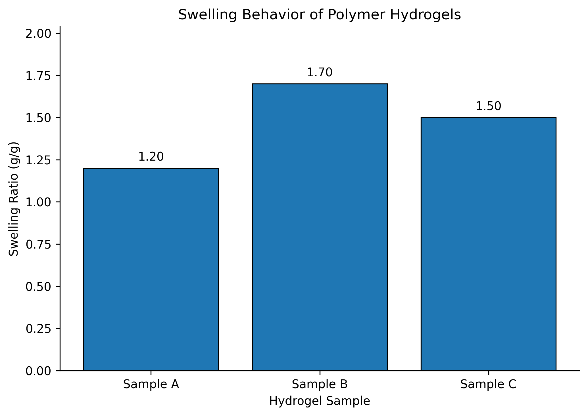

# hydrogel-swelling-analysis
Python-based analysis and visualization of polymer hydrogel swelling behavior for Chemical Engineering research.
Hydrogel Swelling Analysis

Overview

This project explores the analysis and visualization of polymer hydrogel swelling behavior using Python.

Research Motivation

Understanding hydrogel swelling behavior is relevant to polymer science, biomaterials, and controlled-release material research.

Objectives

* Understand the mathematical basis of swelling ratio.
* Organize measurements in a structured dataset.
* Calculate summary statistics.
* Visualize and compare sample results.
* Develop reproducible scientific data-analysis skills.

Methodology

The project will use Python, pandas, and Matplotlib to organize data, perform calculations, and generate figures.

Data Status

The initial notebook will use clearly labeled illustrative data for learning and testing. Experimental findings will only be reported when verified measurements are available and permission to share them has been obtained.

Tools
-Python
-Google Colab
-pandas
-Matplotlib
-GitHub

Planned Deliverables

A Jupyter notebook (.ipynb)
Data-analysis code
Scientific visualizations
Documentation of methods and limitations

Research Relevance

This project is intended to demonstrate introductory scientific computing skills relevant to Chemical Engineering research.

Author

Sumaya Sultana

Chemical Engineering Graduate
Rajshahi University of Engineering & Technology (RUET), Bangladesh

## Swelling Analysis Chart

**Data note:** This figure uses illustrative data for demonstration, not experimental thesis results.

LinkedIn:https://www.linkedin.com/in/sumaiya-sultana-b55298337
